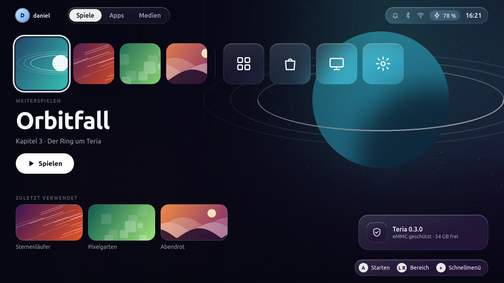

## Neues Design „Glas“ (#59)

Teria sieht jetzt aus wie eine Mischung aus Apples Liquid Glass und der PS5:

- Statusleiste, Bereichsauswahl (Spiele · Apps · Medien) und Tastenhinweise sind Glaskapseln.
- Bibliothek, Store, Desktop und Einstellungen erscheinen als Glaskacheln, durch die der Planet schimmert.
- Schnellmenü, Karten, Dialoge und Schalter sind Glasflächen mit hellem Rand.
- Im PS5-Stil: weißer Auswahlrahmen, weißer „Spielen“-Knopf, große Titel, Kachelreihe oben.

Die Switch hat für die Oberfläche keine GPU-Beschleunigung. Echtes Weichzeichnen in Echtzeit wäre zu langsam, deshalb liegen unter den Glasflächen vorberechnete, weichgezeichnete Hintergründe (`tools/blur-image.py`). Gemessen auf der Switch: 75 ms pro Schritt in der Kachelreihe.

Update ohne Neuflashen: `teria-base` und `teria-shell` 0.5.0 aus diesem Release installieren und neu anmelden.
